# Windows Recon: SMB Nmap Scripts

**Classification:** Assessment Methodologies / Footprinting & Scanning<br>
**Target:** demo.ine.local (10.2.31.54 - Windows Server 2008 R2 / 2012, host WIN-OMCNBKR66MN)<br>
**Credentials provided:** `administrator:smbserver_771`

## 1. Executive Summary

The goal is to fingerprint and enumerate the SMB service of a Windows target using Nmap
NSE scripts. We confirm the host is up, discover the open SMB port, and then run a series
of `smb-*` scripts to enumerate protocol dialects, the security configuration, active
sessions, shares, domains, groups, services and share contents. The scans reveal dangerous
defaults (SMBv1 enabled, message signing disabled) and, with the provided administrator
credentials, full `READ/WRITE` access to `C$`.

## 2. Host Discovery & Port Scan

```bash
ping -c 4 demo.ine.local
```

The TTL of 125 is consistent with a Windows host.

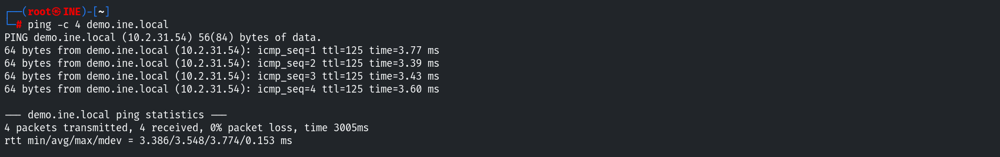

```bash
nmap -Pn -sS -sV -T4 demo.ine.local
```

Ports 135, 139, **445**, 3389 and several high MSRPC ports are open; the OS is identified
as **Windows Server 2008 R2 - 2012**.

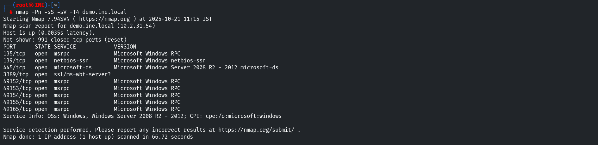

## 3. SMB Protocol Dialects

```bash
nmap -p445 --script smb-protocols demo.ine.local
```

The server supports **NT LM 0.12 (SMBv1)** [dangerous, but default] as well as SMB 2.0.2,
2.1, 3.0 and 3.0.2.

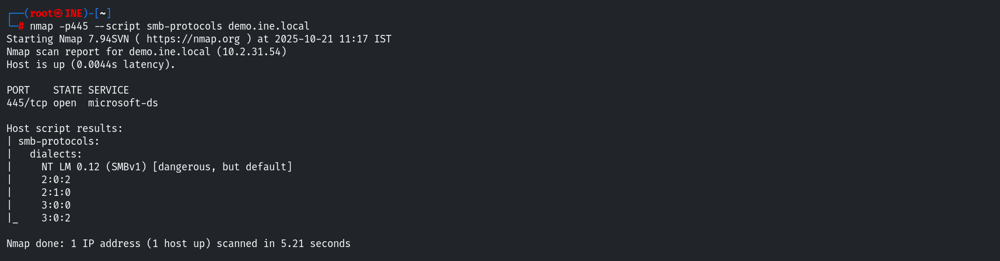

## 4. SMB Security Mode

```bash
nmap -p445 --script smb-security-mode demo.ine.local
```

Message signing is **disabled** (dangerous, but default), which exposes the host to SMB
relay attacks.

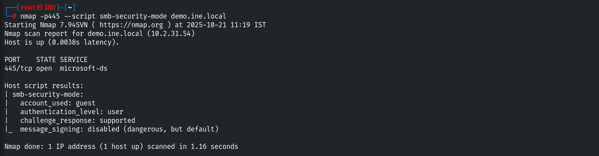

## 5. Session Enumeration

```bash
nmap -p445 --script smb-enum-sessions demo.ine.local
```

Without credentials we can already see that `WIN-OMCNBKR66MN\bob` is logged in.

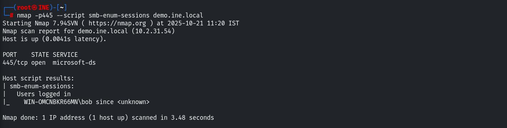

Supplying the provided credentials reveals additional detail, including the active
`ADMINISTRATOR` session connected from `10.10.49.2`.

```bash
nmap -p445 --script smb-enum-sessions --script-args smbusername=administrator,smbpassword=smbserver_771 demo.ine.local
```

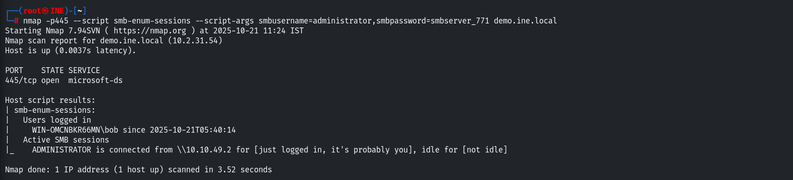

## 6. Share Enumeration (guest)

```bash
nmap -p445 --script smb-enum-shares demo.ine.local
```

As the guest account, we enumerate the shares and their access levels. `IPC$` and the
per-user `Documents`/`Downloads` shares are readable.

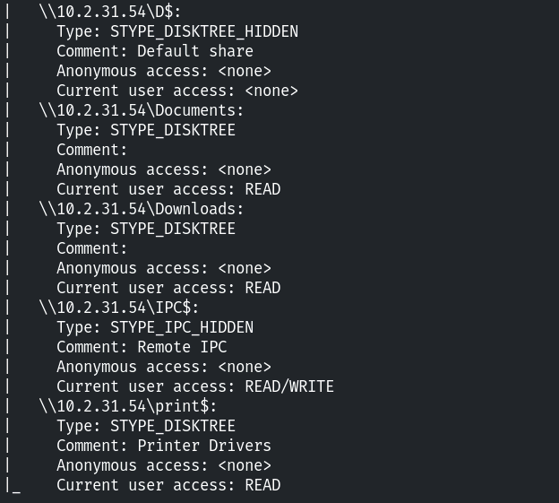

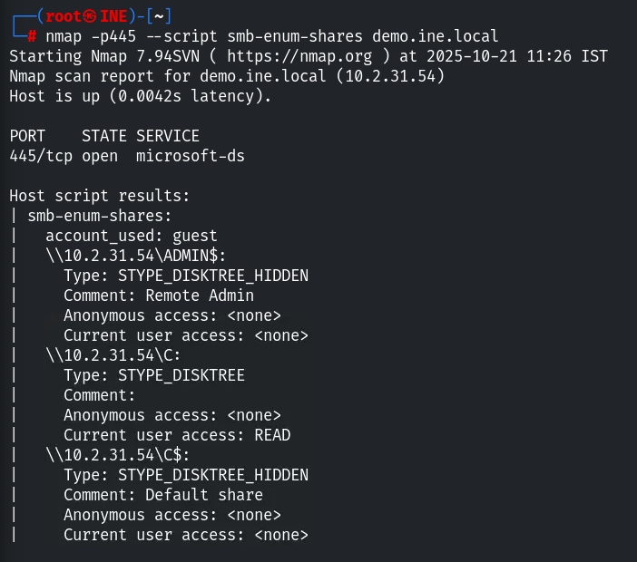

## 7. Share Enumeration (authenticated)

```bash
nmap -p445 --script smb-enum-shares --script-args smbusername=administrator,smbpassword=smbserver_771 demo.ine.local
```

Authenticated as `administrator`, we now have **READ/WRITE** access to `ADMIN$` (C:\Windows)
and the entire `C$`.

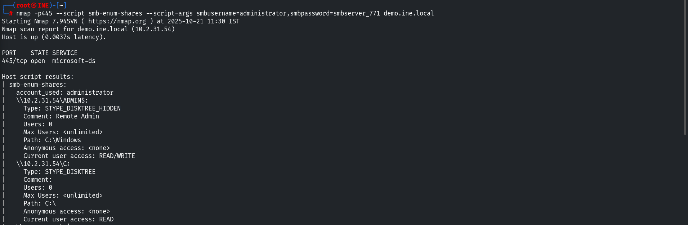

## 8. Server, Domain, Group & Service Enumeration

```bash
nmap -p445 --script smb-server-stats --script-args smbusername=administrator,smbpassword=smbserver_771 demo.ine.local
```

Server statistics show 51 failed logins and 11 permission errors.

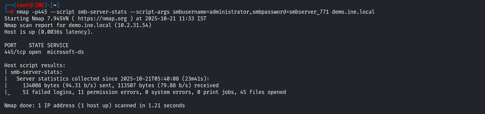

```bash
nmap -p445 --script smb-enum-domains --script-args smbusername=administrator,smbpassword=smbserver_771 demo.ine.local
```

Domain information lists the users `Administrator`, `bob`, `Guest`, password policy
(complexity required, account lockout disabled) and the built-in groups.

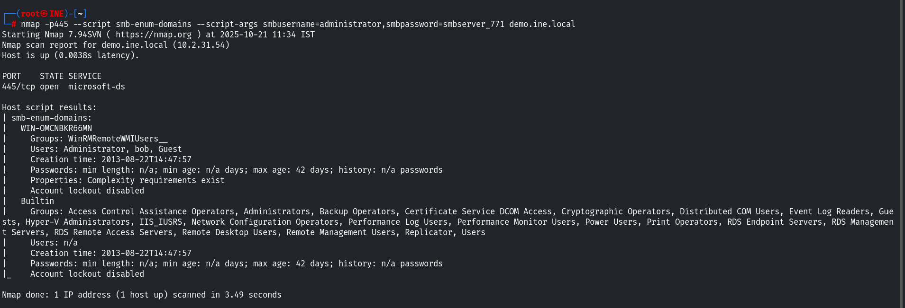

```bash
nmap -p445 --script smb-enum-groups --script-args smbusername=administrator,smbpassword=smbserver_771 demo.ine.local
```

Group membership shows `Administrators: Administrator, bob` and `Remote Desktop Users: bob`.

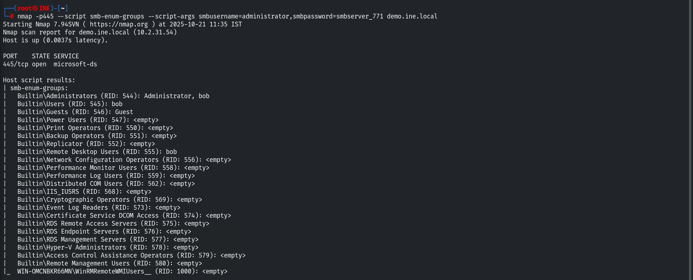

```bash
nmap -p445 --script smb-enum-services --script-args smbusername=administrator,smbpassword=smbserver_771 demo.ine.local
```

Running services are enumerated (Amazon SSM Agent, AWS Lite Guest Agent...).

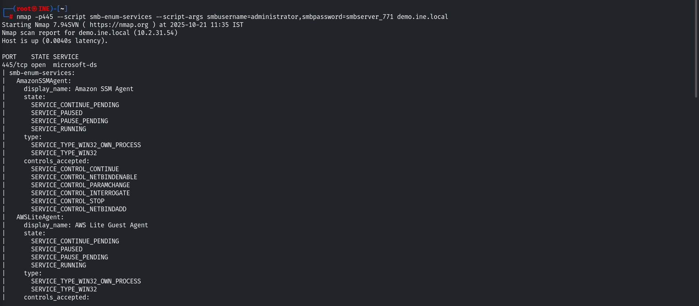

## 9. Listing Share Contents

Finally we combine share enumeration with `smb-ls` to list the files inside each share.

```bash
nmap -p445 --script smb-enum-shares,smb-ls --script-args smbusername=administrator,smbpassword=smbserver_771 demo.ine.local
```

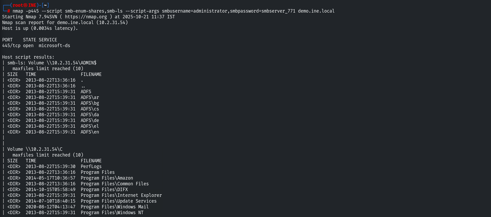

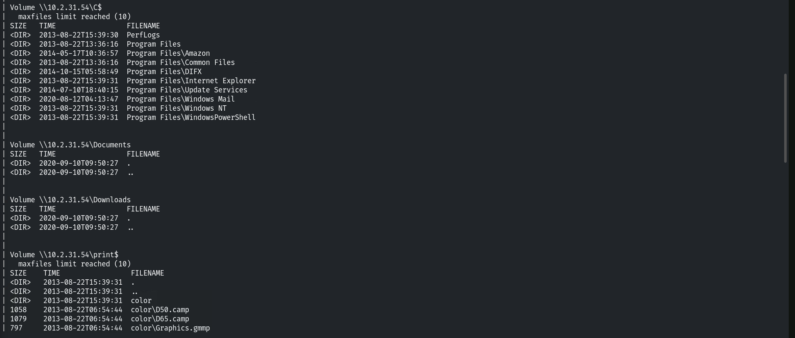

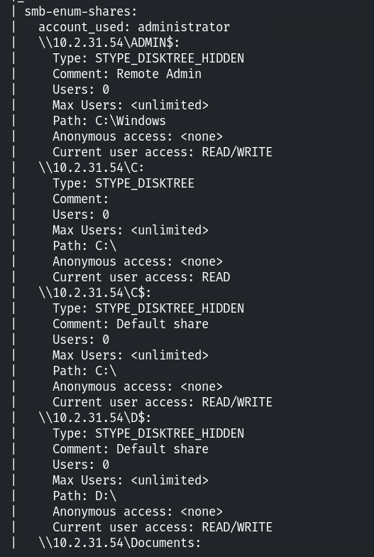

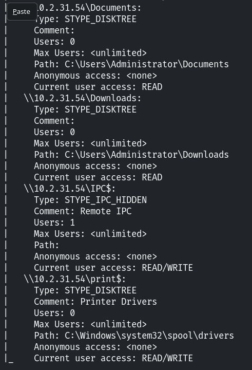

## 10. Remediation Recommendations

1. **Disable SMBv1:** the legacy NT LM 0.12 dialect is dangerous and should be turned off,
   leaving only SMB 2/3.
2. **Enforce SMB signing:** enable message signing to prevent SMB relay attacks.
3. **Enforce strong credentials and account lockout:** the `administrator` account used a
   weak password and account lockout is disabled.
4. **Restrict share and administrative access:** apply least-privilege permissions and
   limit who can reach `ADMIN$`/`C$` over the network.
5. **Limit anonymous/guest enumeration** so recon scripts cannot map sessions, shares and
   users without authentication.
