# WMAP

**Classification:** Assessment Methodologies / Vulnerability Assessment<br>
**Targets:** 192.229.69.3 (WMAP scan - Apache 2.4.18 Ubuntu) and 192.159.71.3 (http_put test)

## 1. Executive Summary

**WMAP** is Metasploit's web application scanning plugin. In this lab we load WMAP, define
the target site/target, and run the full set of web modules against an **Apache 2.4.18**
server, enumerating the server banner, allowed methods, `robots.txt`, directories and
files. We then use the `http_put` auxiliary module to confirm that a directory (`/data/`)
is writable, uploading and reading back a test file.

## 2. Setup

After confirming connectivity, we start PostgreSQL and launch MSF Console.

```bash
ping -c 4 192.229.69.3
service postgresql start
msfconsole -q
```

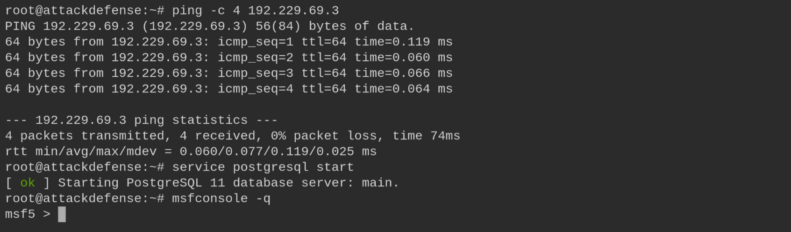

We create a dedicated workspace and set the global target variables.

```bash
workspace -a WMAP
setg RHOSTS 192.229.69.3
setg RHOST 192.229.69.3
```

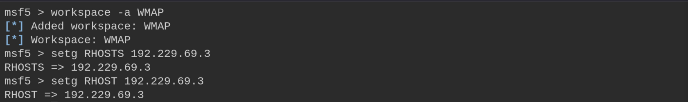

## 3. Loading WMAP

```bash
load wmap
```

The plugin exposes the `wmap_sites`, `wmap_targets`, `wmap_run`, `wmap_nodes`,
`wmap_modules` and `wmap_vulns` commands.

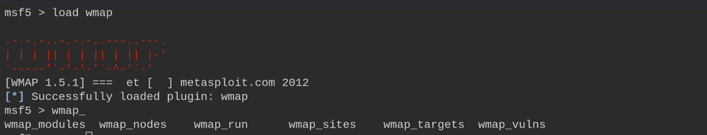

## 4. Defining Site & Target

```bash
wmap_sites -a 192.229.69.3
wmap_sites -l
```

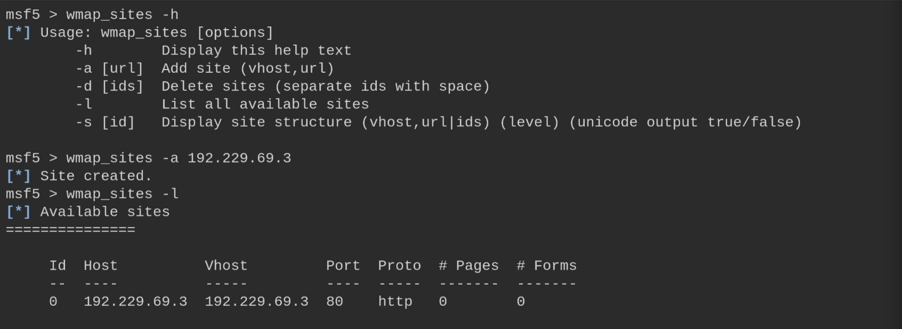

```bash
wmap_targets -t http://192.229.69.3/
wmap_targets -l
```

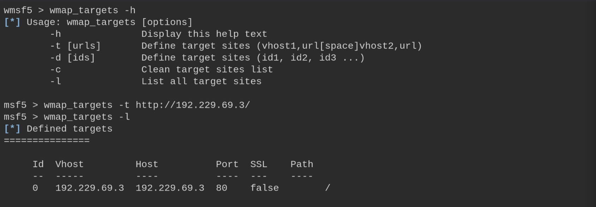

## 5. Listing the Enabled Modules

```bash
wmap_run -t
```

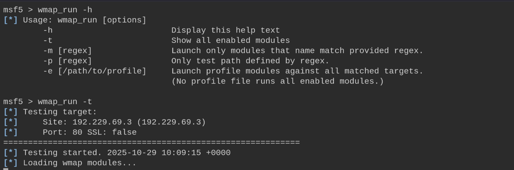

39 modules are enabled, grouped by category (SSL, Web Server, File/Dir, Query...).

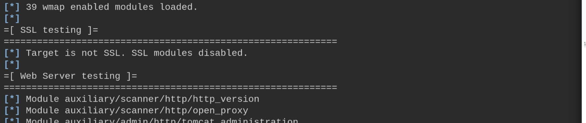

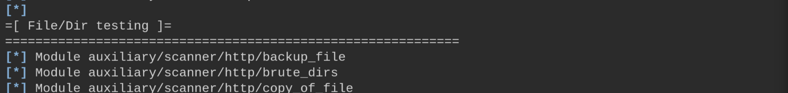

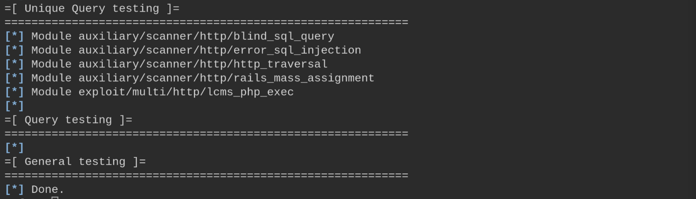

## 6. Running the Scan

```bash
wmap_run -e
```

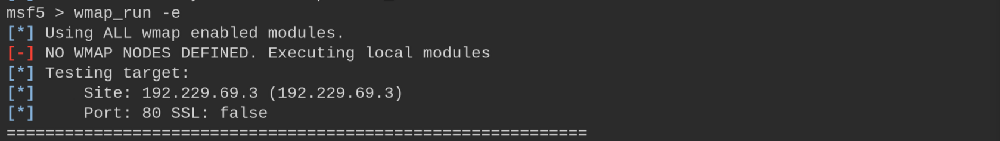

The Web Server tests fingerprint **Apache/2.4.18 (Ubuntu)**.

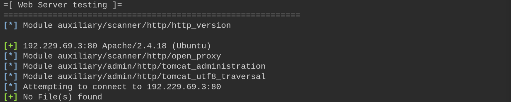

Further modules enumerate the allowed methods (`POST, OPTIONS, GET, HEAD`), read
`robots.txt` (`Allow: /webmail`, `Disallow: /data`, `/secure`) and scrape the default page.

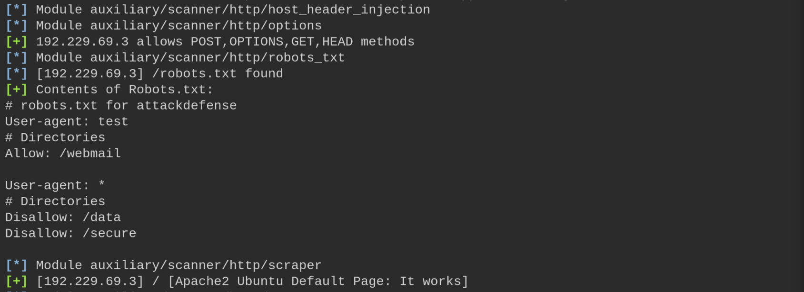

Directory brute-forcing discovers several paths (`/doc`, `/pro`, `/downloads`...).

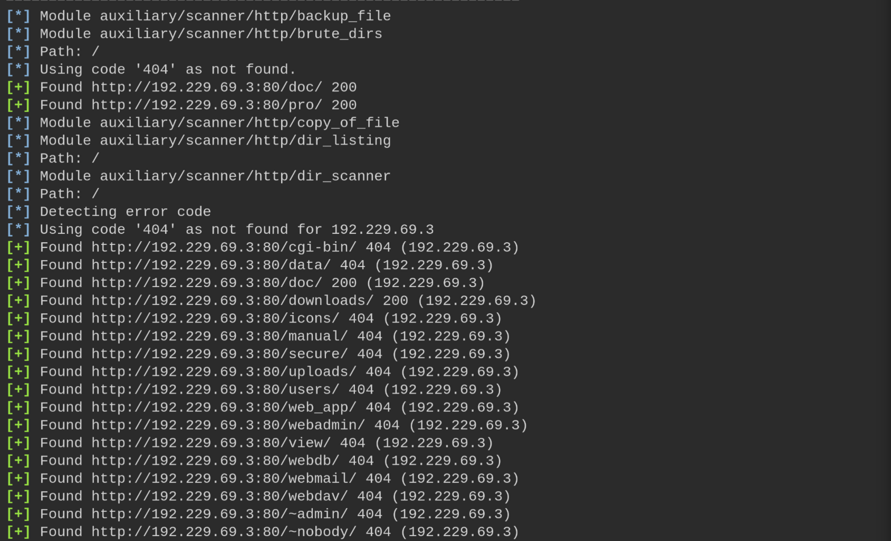

File scanning finds backup and source files (`file.backup`, `code.c`, `code.cfg`).

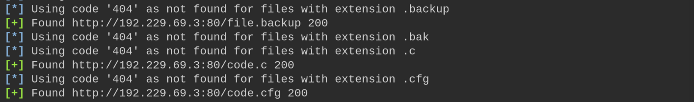

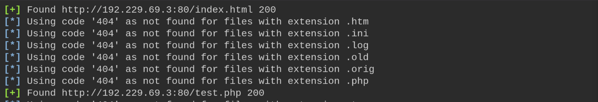

Directory enumeration returns the status codes for each path (301/401/403); `/secure` and
`/webdav` return 401.

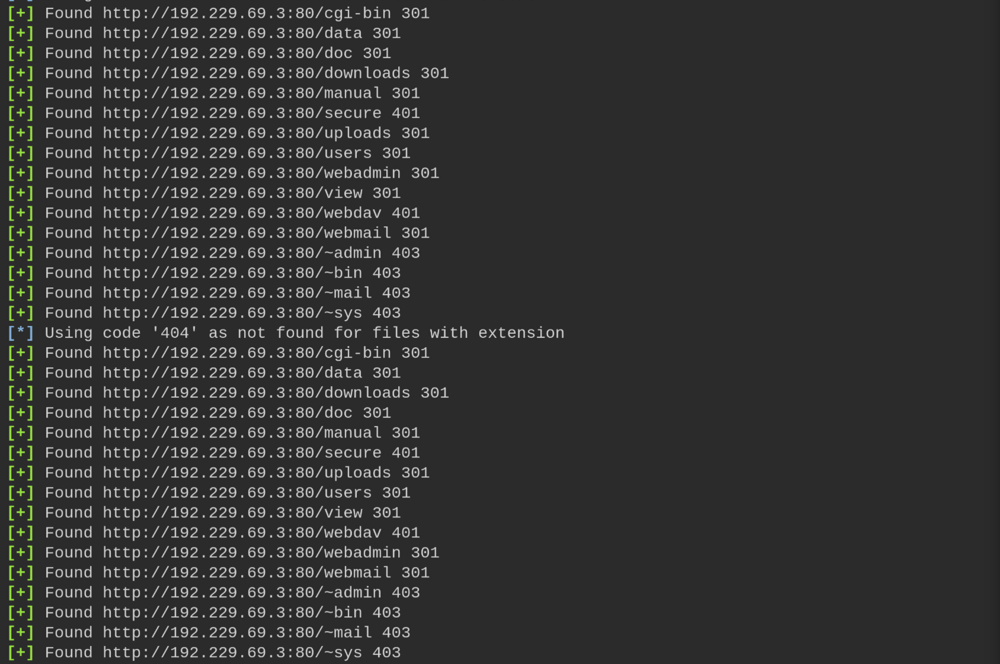

The scan completes after ~310 seconds.

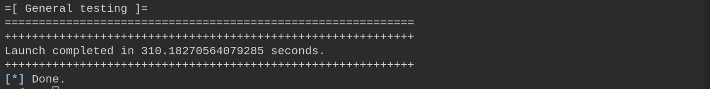

## 7. Testing Writable Directories (http_put)

We first review the allowed HTTP methods with the `options` module.

```bash
use auxiliary/scanner/http/options
run
```

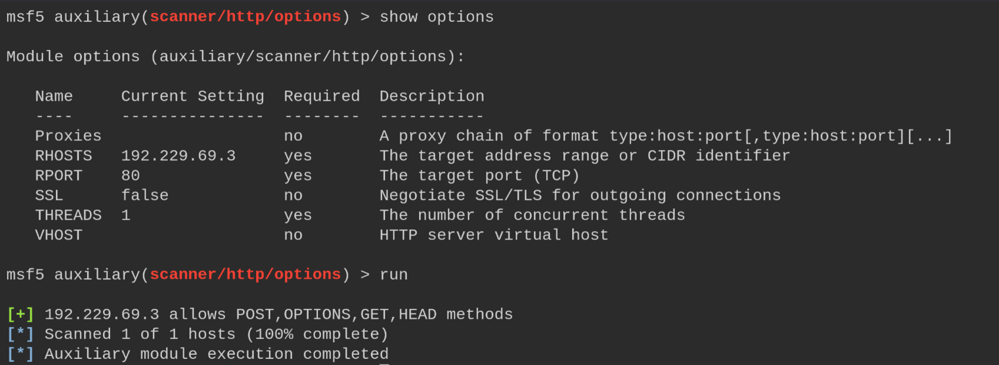

Then we try the `http_put` module to upload a file. On the web root (`/`) the upload
fails.

```bash
use auxiliary/scanner/http/http_put
run
```

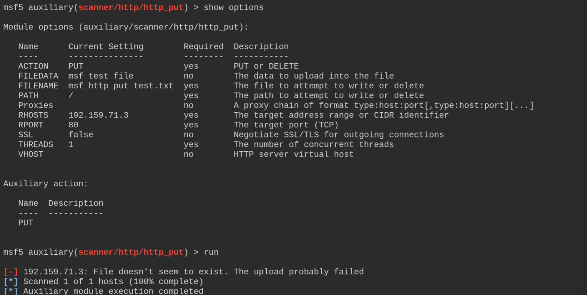

Setting the path to `/data/` (writable) the upload succeeds.

```bash
set PATH /data/
run
```

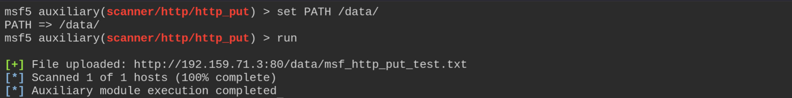

We confirm write access by changing the file name/data and reading it back with `curl`.

```bash
set FILENAME this_works.txt
set FILEDATA "This does work ||| "
run
curl http://192.159.71.3:80/data/this_works.txt
```

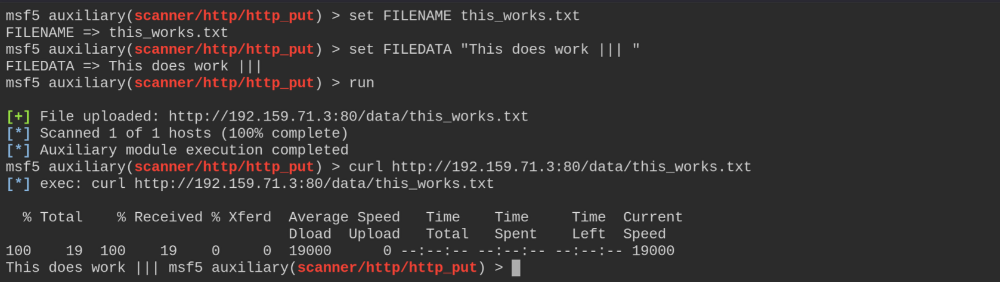

## 8. Remediation Recommendations

1. **Disable the HTTP `PUT`/`DELETE` methods** and make web directories non-writable to
   prevent arbitrary file uploads.
2. **Remove sensitive/backup files** (`file.backup`, `code.c`, `code.cfg`) from the web
   root and disable directory listing.
3. **Protect restricted paths with real authentication:** `robots.txt` is not a security
   control.
4. **Suppress the server version banner** and keep Apache up to date.
